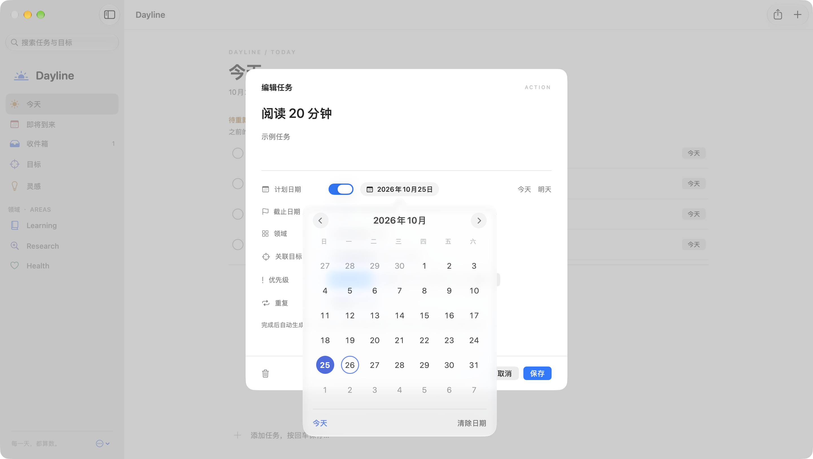
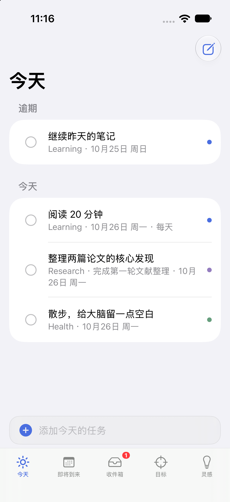

<p align="center">
  
</p>

<h1 align="center">Dayline</h1>

<p align="center">
  A local-first productivity workspace for macOS.<br>
  Plan the day you actually have, and keep the longer goals in sight.
</p>

<p align="center">
  <a href="README_CN.md">中文</a> ·
  <a href="docs/INSTALL_WITH_AI.md">Install with AI</a> ·
  <a href="CONTRIBUTING.md">Contributing</a>
</p>

Dayline is a native macOS app for personal tasks, goals, and ideas. It is built with SwiftUI and SwiftData. Your data stays in a database on your Mac. There is no account and no network sync.

The Mac app is the version meant for daily use. An experimental iPhone app can build from the same repository. The two apps do not sync. CloudKit is not implemented.

The interface is Chinese. Dates, areas, and sample content follow that language.

## What it does

- **Today.** Tasks scheduled for today or due today, grouped by area. Unfinished earlier plans stay in a separate “reschedule” section. Dayline does not silently move them onto today.
- **Upcoming and Inbox.** The next week, plus tasks that have no area, no planned date, and no linked goal.
- **Goals.** Long-term and short-term goals, optional parent goals, a date, and a progress value you set yourself. Completing tasks does not rewrite that progress.
- **Ideas.** Notes you can pin, archive, link to an area or goal, and turn into a task.
- **Repeating tasks.** Daily or weekly. Completing one creates the next occurrence and skips missed periods instead of backfilling them.
- **Export.** PDF, PNG, or Markdown for a date range or selected ideas. Existing files are not overwritten.
- **History.** A read-only view of what was planned and what was finished. Capacity notes appear only after enough completed planning days, and they never edit your tasks.

Sample content is optional. A new library starts with three areas — Learning, Research, and Health — and an empty workspace.

<p align="center">
  
</p>

<p align="center">
  
</p>

<p align="center">
  
</p>

<p align="center">
  
</p>

## Requirements

- macOS 14 or later
- Apple Command Line Tools, or Xcode
- Apple silicon or Intel, for a build made on that Mac

There is no Developer ID signature and no notarization. A build you make on your own Mac is ad-hoc signed for that Mac. Do not download an ad-hoc binary from someone else, and do not turn off Gatekeeper to open one. Install from source instead.

## Install

### On your Mac

```bash
git clone https://github.com/dushiye/Dayline.git
cd Dayline
scripts/check-environment.sh
scripts/build-macos.sh
scripts/install-macos.sh "$HOME/Applications/Dayline.app"
open "$HOME/Applications/Dayline.app"
```

`scripts/check-environment.sh` reports the macOS version, Swift, and the developer directory. `scripts/build-macos.sh` compiles a release build and does not install it. The app bundle is assembled under `~/Library/Caches/DaylineBuild/` because Desktop file providers can break code signing. `build/Dayline.app` in the repository is only a shortcut to that cache.

`scripts/install-macos.sh` copies that bundle to a path you choose. It does not read or write `~/Library/Application Support/Dayline`.

- A path that does not exist yet is created. That includes a first install to `~/Applications/Dayline.app`.
- Replacing an existing `~/Applications/Dayline.app` requires `DAYLINE_REPLACE_INSTALLED=yes`. The previous app is renamed, not deleted.
- Replacing any other existing path requires `DAYLINE_REPLACE_DESTINATION=yes`.
- The script refuses to install into the personal data directory.

No `sudo` is required. Running the scripts again is safe: a second build overwrites the cache bundle, and a second install stops unless you set the matching confirmation variable.

You can also double-click `安装 Dayline.command` in Finder. If an app is already installed, Terminal asks before moving it aside.

### From Xcode

```bash
open Dayline.xcodeproj
```

Open the `.xcodeproj` file, not the repository folder. The root `Package.swift` makes Xcode treat the folder as a Swift package, which hides the Mac and iOS schemes.

Choose the **Dayline** scheme and **My Mac**. The Mac app has no third-party packages.

### Update

```bash
git pull
DAYLINE_REPLACE_INSTALLED=yes scripts/install-macos.sh "$HOME/Applications/Dayline.app"
```

Updating the app does not replace the database. Before a risky experiment, use **导出备份…** in the sidebar menu and keep that JSON somewhere else. Backups are readable plain text.

### Install with AI

Copy the prompt in [docs/INSTALL_WITH_AI.md](docs/INSTALL_WITH_AI.md) into Cursor, Codex, or another coding agent. The agent is instructed to build from source, refuse to touch an existing personal database, and ask before replacing an installed app.

## Using Dayline

- **New task:** `⌘N`, or the **+** button. A title is enough.
- **Dates:** planned date is when you intend to do the task. Due date is the latest day. Both use the same calendar popover. Clearing a date turns that field off.
- **Search:** tasks, goals, and idea text.
- **Ideas:** sidebar **灵感**. Turning an idea into a task keeps the original idea.
- **Export:** `⇧⌘E`.
- **Appearance:** follow the system, or choose light or dark.
- **Sample content:** sidebar menu, **添加示例内容**. You can delete it later.

## Data and privacy

The database lives at:

```text
~/Library/Application Support/Dayline/Dayline.store
```

The same folder holds the SQLite WAL and SHM files, a pre-upgrade snapshot when one was created, and automatic JSON backups. Quit Dayline before copying that folder. Do not delete or replace the database, WAL, or SHM while the app is running.

There is no account, no analytics endpoint, and no cloud sync in this repository. A backup file contains your tasks in plain JSON. Treat it as a private document.

## Mac and iOS

| | Mac | iPhone |
| --- | --- | --- |
| Status | Daily-use app, version 1.1.1 | Experimental, version 0.1.0 |
| Install | Build from source on your Mac | Xcode, an iOS 17+ simulator, or your own device signing |
| Data | Local SwiftData store | A separate local store |
| Sync | None | None |

The iPhone app includes Today, Upcoming, Inbox, Goals, and Ideas. It is not a finished product, and it is not on the App Store. Installing it on a device needs a free or paid Apple developer signing setup in Xcode on your own machine. This project does not ask for an Apple ID password.

<p align="center">
  
</p>

## Roadmap

- Keep the Mac app reliable for daily use.
- Make source install and updates predictable.
- Improve the experimental iPhone app.
- Design sync only after the local model is ready. CloudKit is a future plan, not a current feature.
- Other platforms are not scheduled.

## Contributing

See [CONTRIBUTING.md](CONTRIBUTING.md). Bug reports and pull requests are welcome. Please do not include personal tasks, database files, or signing credentials.

## License

[MIT](LICENSE). You can use, modify, and redistribute this project, including commercially, as long as the copyright notice and license stay with the code.

## Author

[dushiye](https://github.com/dushiye) · [github.com/dushiye/Dayline](https://github.com/dushiye/Dayline)
