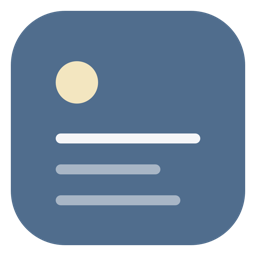
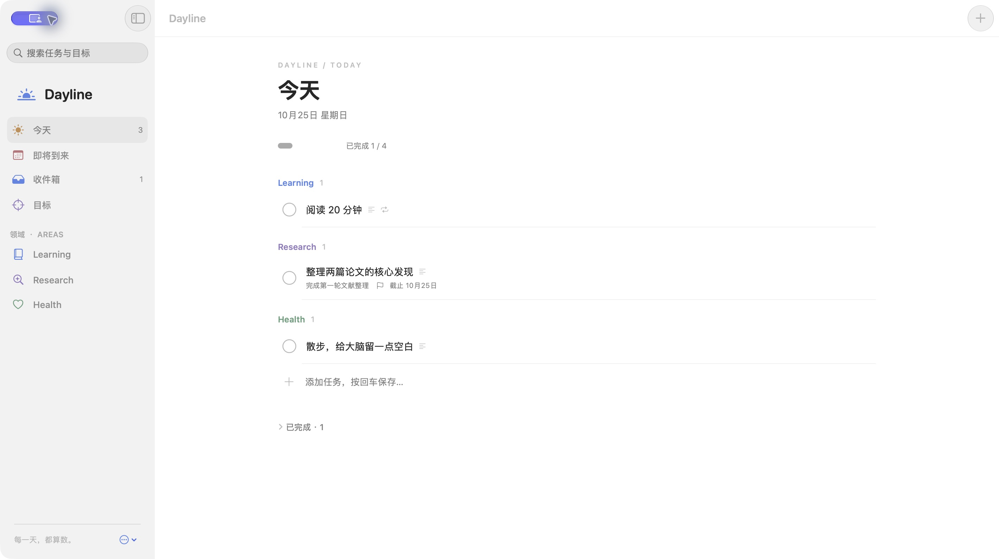
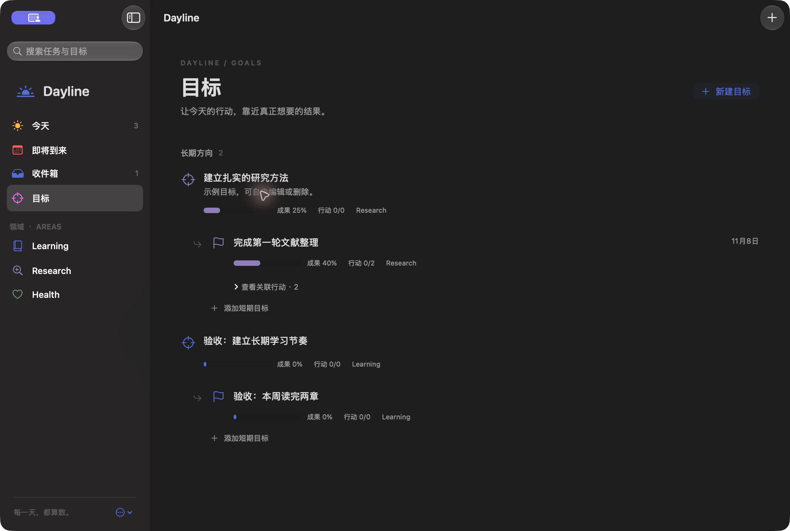
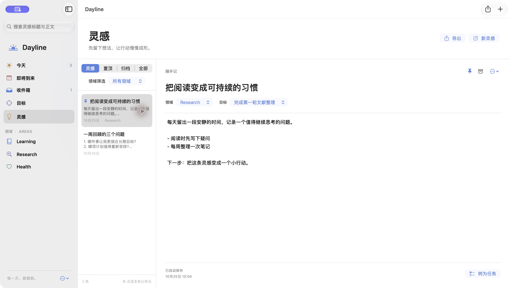

<p align="center">
  
</p>

<h1 align="center">Dayline</h1>

<p align="center">
  计划、目标、灵感，放在同一个 Mac 应用里。<br>
  免费。无广告。不需要账号。
</p>

<p align="center">
  <a href="README.md">English</a> ·
  <a href="#安装">安装</a> ·
  <a href="CONTRIBUTING.md">参与贡献</a>
</p>

Dayline 是一款原生 macOS 应用。今天要做的事、想达成的结果、还没准备排期的想法，都在同一个窗口里。界面是中文。

任务清单容易忘了为什么要做。目标工具容易忘了今天干什么。备忘录容易永远停在想法。Dayline 把这三者连成一条线。

**计划属于今天。** 「今天」只放计划在今天、或今天到期的事，并按 Learning、Research、Health 分组。更早没做完的计划留在「待重新安排」。早上打开的清单，就是你决定要过的这一天。

**目标看的是结果。** 长期目标下面可以挂短期目标。成果进度由你来填。任务完成，说明行动在推进；目标走到哪一步，由你判断。

**灵感可以先放着。** 一条想法可以置顶，可以挂到领域或目标上，也可以在它成熟时转成任务。原来的灵感还在，做这件事的理由不会丢。

每天或每周要重复的事，完成这一次就会接上下一次。导出可以把一段时间的计划，或你选中的灵感，做成 PDF、PNG 或 Markdown。历史让你看见这些天实际是怎么度过的。

<p align="center">
  
</p>

<p align="center">
  
</p>

<p align="center">
  
</p>

## 安装

需要 macOS 14 或更新版本，以及 Xcode 或 Command Line Tools。

### 交给 AI

这是最省事的办法。把下面这段复制给这台 Mac 上的 Cursor、Codex 或其他编程助手。

```text
请在这台 Mac 上安装 Dayline：https://github.com/dushiye/Dayline

阅读 README_CN.md 和 docs/INSTALL_WITH_AI.md。检查环境，获取源码，完成构建，安装到 ~/Applications/Dayline.app，然后告诉我怎么打开。
```

完整提示词在 [docs/INSTALL_WITH_AI.md](docs/INSTALL_WITH_AI.md)。

### 自己安装

```bash
git clone https://github.com/dushiye/Dayline.git
cd Dayline
scripts/check-environment.sh
scripts/build-macos.sh
scripts/install-macos.sh "$HOME/Applications/Dayline.app"
open "$HOME/Applications/Dayline.app"
```

也可以在 Finder 里双击 `安装 Dayline.command`。

已经装过、想更新时：

```bash
git pull
DAYLINE_REPLACE_INSTALLED=yes scripts/install-macos.sh "$HOME/Applications/Dayline.app"
```

你写下的计划、目标和灵感会留在原地。要改代码，打开 `Dayline.xcodeproj`，选择 **Dayline** scheme 和 **My Mac**。

## 一天怎么用

- **记下来：** `⌘N` 或右上角 **+**。只写标题也行。
- **放在哪一天：** 计划日期是准备做的那天，截止日期是最晚的那天。两者用同一个日历。
- **找回来：** 搜索可以穿过任务、目标和灵感。
- **留住那个念头：** 侧边栏 **灵感**。转成任务之后，原来的灵感还在。
- **带走一段时间：** `⇧⌘E` 导出 PDF、PNG 或 Markdown。
- **看起来舒服：** 外观可以跟随系统，也可以指定浅色或深色。想先看看样子，用侧边栏菜单里的 **添加示例内容**。

## 你的内容

你写下的东西保存在这台 Mac 上。想另存一份，用侧边栏菜单里的 **导出备份…**。

## 许可证

[MIT](LICENSE)。可以自由使用、修改和分享。

## 作者

[dushiye](https://github.com/dushiye) · [github.com/dushiye/Dayline](https://github.com/dushiye/Dayline)
